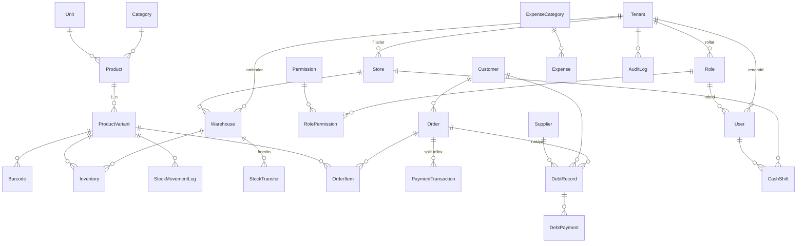

# Savdo ERP — Arxitektura hujjati

Holat: **1–3 bosqich yakunlangan** (monorepo, ma'lumotlar modeli, RLS, RBAC,
tenant auth, tranzaksiyali sales engine, kassa smenalari, idempotent sync API).
Hujjat keyingi bosqichlar uchun majburiy shartnomalarni belgilaydi.

---

## 1. Maqsad va tamoyillar

1. **Do'kon egasi uchun sodda, moliya uchun qat'iy.** Har bir chek, qarz va ombor
   harakati pul va tannarx bilan bog'langan holda yoziladi.
2. **Offline-first kassa.** Internet uzilishi savdoni to'xtatmaydi; chek mahalliy
   navbatda saqlanadi va aloqa tiklanganda idempotent yuboriladi.
3. **Tenant izolyatsiyasi ikki qatlamda.** Ilova har bir so'rovda `tenantId` bilan
   filtrlaydi; PostgreSQL RLS mustaqil ravishda faqat joriy tenant qatorlarini beradi.
4. **Pul — `Decimal`, hech qachon `float` emas.** UZS `Decimal(14,2)`, miqdor
   `Decimal(14,3)` (kg/metr uchun).
5. **Audit bilan o'zgarmas faktlar.** Narx, chegirma, bekor qilish va qarz
   o'zgarishlari `AuditLog`da kim/qachon/before/after bilan saqlanadi.
6. **Platformalar umumiy yadro ustida.** Web, desktop va mobil bir xil Zod
   sxemalari, RBAC katalogi va sync shartnomasidan foydalanadi.

---

## 2. Maqsadli topologiya

```text
┌──────────────┐  ┌──────────────┐  ┌──────────────┐  ┌─────────────────┐
│ apps/web     │  │ apps/desktop │  │ apps/mobile  │  │ apps/telegram-bot│
│ Next.js 14   │  │ Tauri 2      │  │ Expo/RN      │  │ grammY           │
│ Admin portal │  │ POS + ESC/POS│  │ POS/monitoring│ │ eslatma + TMA    │
└──────┬───────┘  └──────┬───────┘  └──────┬───────┘  └────────┬────────┘
       │                 │                 │                   │
       └────────────┬────┴─────────────────┴───────────────────┘
                    ▼
          ┌─────────────────────────────┐
          │ Backend (keyingi: NestJS)   │
          │ REST + WebSocket + BullMQ   │
          │ Sync engine / tranzaksiyalar│
          └──────────────┬──────────────┘
                         ▼
        ┌───────────────────────────────────┐
        │ PostgreSQL 15+ (single DB/tenant) │
        │ Prisma · RLS · audit · PITR       │
        └───────────────────────────────────┘
                         │
              Redis (cache, rate-limit, queue)
```

3-bosqichda savdo/sync yadrosi web ilovaning API route handlerlari ichida
(`apps/web/src/lib/sales`) amalga oshirildi. Domen qatlami `withTenantContext`
va `packages/shared` shartnomalariga tayangani uchun keyingi bosqichda uni
`apps/backend` (NestJS) ga ko'chirish mumkin; web, desktop va mobil bir xil
REST shartnomasidan foydalanadi. Autentifikatsiya JWT shartnomasi o'zgarmaydi.

---

## 3. Monorepo tuzilishi

```text
apps/
  web/            Next.js 14 (App Router), admin portal + POS (4-bosqich)
  backend/        NestJS modular monolith (keyingi ajratish)  ← hali yo'q
  desktop/        Tauri 2 + React POS (5-bosqich)      ← hali yo'q
  mobile/         Expo/React Native (6-bosqich)        ← hali yo'q
  telegram-bot/   grammY bot + mini app (6-bosqich)    ← hali yo'q
packages/
  database/       Prisma sxema, migratsiyalar, seed, withTenantContext
  shared/         Permission katalogi, Zod DTO, money/date, sync turlari
  ui/             Radix + Tailwind dizayn tizimi
scripts/
  dev-db.mjs      Lokal embedded PostgreSQL
  verify-rls.mjs  RLS izolyatsiya testi
  verify-sales.mjs Sales/sync/smena HTTP + DB testi (43 ta check)
```

Ichki paketlar **source-only** (`main: src/index.ts`), Next ularni
`transpilePackages` bilan kompilyatsiya qiladi; alohida build qadami yo'q.
Bu dev tezligini oshiradi; paket tashqariga npm'ga chiqarilsa, `tsup` build qo'shiladi.

---

## 4. Ma'lumotlar modeli

28 model, 26 tasi tenantga tegishli va RLS bilan himoyalangan.

### 4.1 Domenlar

| Domen | Modellar |
| --- | --- |
| SaaS yadro | `Tenant`, `User`, `Role`, `Permission`, `RolePermission`, `Session` |
| Tashkilot | `Store` (filial), `Warehouse` |
| Katalog | `Category` (daraxt), `Unit`, `Product`, `ProductVariant`, `Barcode` |
| Ombor | `Inventory`, `StockMovementLog`, `StockTransfer`, `StockTransferItem` |
| Kontragentlar | `Customer`, `Supplier`, `DebtRecord`, `DebtPayment` |
| Savdo | `Order`, `OrderItem`, `PaymentTransaction` |
| Kassa | `CashShift` |
| Moliya | `ExpenseCategory`, `Expense` |
| Audit | `AuditLog` |

### 4.2 Asosiy relationlar



### 4.3 Dizayn qarorlari

- **Narx va tannarx variantda.** Simple tovarda ham bitta `ProductVariant`
  (`isDefault=true`, nomi `Standart`) yaratiladi. Bu ombor va savdo mantiqini
  bitta yo'lga keltiradi; keyinchalik o'lcham/rang qo'shish migratsiyasiz ishlaydi.
- **Chekdagi snapshot.** `OrderItem` tovar nomi, variant nomi, sotish narxi va
  **tannarxni** saqlaydi. Tovar keyin o'zgarsa ham eski chek foydasi to'g'ri qoladi.
- **Denormalizatsiya qilingan balanslar.** `Customer.debtBalance`,
  `Supplier.balanceDebt` — tez kredit-limit tekshiruvi uchun. Haqiqiy manba
  `DebtRecord`; balans har bir tranzaksiyada qayta hisoblanadi/yangilanadi.
- **Bir vaqtda ikki manba emas.** Qarz `Order.debtAmount` + `DebtRecord` orqali
  yoziladi; to'lov `PaymentTransaction` (chek to'lovi) yoki `DebtPayment` (qarz
  yopish) bilan. Ikkalasi `PaymentTransaction.debtPaymentId` orqali bog'lanadi.
- **Buyurtma raqami** `@@unique([tenantId, number])`; offline chek
  `@@unique([tenantId, offlineId])` — takroriy sync'da dublikat yaratilmaydi.
  Raqam `Order_number_seq` global sequence'dan olinadi: u tranzaksiyani
  bloklamaydi, lekin rollback bo'lganda raqamda gap qolishi mumkin (invoice
  uchun normal holat).
- **Smena bog'lanishi.** `Order.shiftId` har bir chekni aniq smenaga bog'laydi;
  `CashShift` yopilganda naqd/karta/o'tkazma/boshqa/qarz yig'indilari va kassa
  farqi (`closingCash - expectedCash`) o'sha qatorlarga yoziladi. Bir
  foydalanuvchida bitta ochiq smena — partial unique index bilan kafolatlangan.
- **Barcha unikal kalitlar tenant bilan.** `Barcode.code`, `Order.number`,
  `Customer.phone`, `Role.code`, `Store.code` — har biri `tenantId` bilan birga.
- **O'chirish siyosati.** Moliyaviy yozuvlar `Restrict` (chekni jismonan o'chirib
  bo'lmaydi, faqat bekor qilinadi); agregatlar `Cascade`.
- **Pul/miqdor.** `Decimal(14,2)` va `Decimal(14,3)`; JavaScriptda faqat
  chegarada `Number()`ga o'giriladi. Prisma `Decimal` arifmetikasi ishlatiladi.

### 4.4 Indekslar

Har bir jadvalda `tenantId` indekslangan. Amaliyotdagi asosiy so'rovlar uchun
kompozit indekslar: `[tenantId, createdAt]`, `[tenantId, storeId, createdAt]`,
`[tenantId, variantId]`, `[warehouseId, variantId]` (unique), `[tenantId, status]`,
`[tenantId, dueDate]`, `[tenantId, entityType, entityId]`.
Katta hajmda `Order` oylik partition, `StockMovementLog`/`AuditLog` uchun
TimescaleDB yoki partition qo'llanadi (5-bosqich).

---

## 5. Multi-tenancy va RLS

### 5.1 Model

- **Bitta PostgreSQL bazasi**, har jadvalda `tenantId`.
- Har bir biznes = bitta `Tenant`; filiallar `Store`, omborlar `Warehouse`.
- Login **biznes kodi (`slug`) + telefon + parol** bilan. Bu tenant kontekstini
  autentifikatsiyadan oldin aniqlash imkonini beradi.
- `Tenant` jadvali ataylab RLSdan tashqarida: u routing jadvali (slug bo'yicha
  biznesni topish). Boshqa barcha tenant jadvallari RLS bilan yopilgan.
  `Permission` — global katalog.

### 5.2 RLS mexanizmi

Migratsiya: `packages/database/prisma/migrations/20261023182600_tenant_row_level_security`.

```sql
ALTER TABLE "Order" ENABLE ROW LEVEL SECURITY;
CREATE POLICY tenant_isolation ON "Order"
  USING ("tenantId" = current_setting('app.tenant_id', true))
  WITH CHECK ("tenantId" = current_setting('app.tenant_id', true));
```

Ilova kontekstni tranzaksiya ichida o'rnatadi:

```ts
await withTenantContext(tenantId, async (tx) => {
  // set_config('app.tenant_id', $1, true)
  return tx.order.findMany();
});
```

`packages/database/src/tenant.ts` shu helperni beradi. Kontekst o'rnatilmasa
`current_setting(..., true)` `NULL` qaytaradi va hech qanday qator ko'rinmaydi.

### 5.3 RLSni productionda yoqish

Table owner RLSni chetlab o'tadi. Shuning uchun:

```sql
CREATE ROLE savdo_app LOGIN PASSWORD 'KUCHLI_PAROL' NOSUPERUSER NOCREATEROLE;
GRANT CONNECT ON DATABASE savdo TO savdo_app;
GRANT USAGE ON SCHEMA public TO savdo_app;
GRANT SELECT, INSERT, UPDATE, DELETE ON ALL TABLES IN SCHEMA public TO savdo_app;
GRANT USAGE, SELECT ON ALL SEQUENCES IN SCHEMA public TO savdo_app;
ALTER DEFAULT PRIVILEGES IN SCHEMA public
  GRANT SELECT, INSERT, UPDATE, DELETE ON TABLES TO savdo_app;
```

- `DATABASE_URL` — `savdo_app` (RLS amal qiladi).
- Migratsiya/seed — owner roli (`MIGRATE_DATABASE_URL`, alohida job).
- `npm run db:verify-rls` shu stsenariyni lokal bazada tekshiradi.

### 5.4 Cheklovlar (ochiq ro'yxat)

- `Tenant` va `Permission` RLSdan tashqarida (routing/katalog).
- Telefon global unikal. Telefon bir nechta tenantda ishlatilishi kerak bo'lsa,
  `@@unique([tenantId, phone])` ga o'tilib, login slug bilan cheklanadi (migratsiya kerak).
- JWTdagi ruxsatlar 7 kungacha amal qiladi; rol o'zgarsa foydalanuvchini
  qayta login qilish yoki `roleVersion` qo'shish kerak (5-bosqich).

---

## 6. Autentifikatsiya va granular RBAC

### 6.1 Oqim

1. `POST /api/auth/login` — `{ tenantSlug, phone, password }`.
2. Slug bo'yicha `Tenant` topiladi (faol bo'lishi shart).
3. `withTenantContext` ichida user + roli + permissionlari o'qiladi.
4. `bcrypt.compare` (mavjud bo'lmagan user uchun ham dummy hash — timing).
5. `Session` yoziladi, `AuditLog(LOGIN)` yaratiladi, `lastLoginAt` yangilanadi.
6. HS256 JWT (7 kun) HttpOnly cookie sifatida o'rnatiladi: `sub`, `sessionId`,
   `tenantId`, `roleCode`, `permissions[]`.
7. Har bir server so'rovida `getSession()` JWTni **va** DB sessiyasini tekshiradi
   (bekor qilingan/expired sessiya ishlamaydi). React `cache` bilan dedupe qilinadi.
8. Middleware Edge'da faqat JWT va route→permission mosligini tekshiradi;
   qat'iy tekshiruv server komponenti/APIda (`requirePageUser`, `requirePermission`).

### 6.2 Ruxsatlar (27 ta) va rollar (6 ta)

Ruxsat katalogi — `packages/shared/src/permissions.ts`, DBdagi `Permission.key`
bilan aynan bir xil.

| Modul | Ruxsatlar |
| --- | --- |
| Boshqaruv | `dashboard.view`, `reports.export`, `audit.view` |
| Kassa | `pos.use`, `pos.discount`, `shifts.manage` |
| Savdo | `sales.view`, `sales.create`, `sales.refund`, `sales.cancel` |
| Mijozlar | `customers.view`, `customers.manage`, `customers.pay` |
| Tovar | `products.view`, `products.viewCost`, `products.manage` |
| Ombor | `inventory.view`, `inventory.manage`, `inventory.transfer` |
| Ta'minot | `suppliers.view`, `suppliers.manage` |
| Moliya | `finance.view`, `finance.manage`, `expenses.manage` |
| Tizim | `staff.manage`, `settings.manage`, `sync.manage` |

| Rol | Ruxsatlar |
| --- | --- |
| `SUPER_ADMIN` | Barchasi |
| `BRANCH_MANAGER` | Dashboard, kassa, savdo (+cancel/refund), mijoz, tovar, ombor, ta'minot, finance.view, expenses, smena |
| `SENIOR_SELLER` | Kassa + chegirma, savdo (+refund), mijozlar, tovarni ko'rish |
| `CASHIER` | Kassa, savdo yaratish/ko'rish, mijoz qarzini qabul qilish |
| `WAREHOUSE` | Tovar, ombor, reviziya, transfer, ta'minot |
| `ACCOUNTANT` | Dashboard, savdo (ko'rish), moliya, xarajat, ta'minot, audit |

Kassir `products.viewCost`ga ega emas — keyingi bosqichdagi API tannarx va
foydani unga qaytarmaydi. Bu **server darajasida** ta'minlanadi, UIda yashirish yetarli emas.

---

## 7. Offline-first sync shartnomasi

### 7.1 Tamoyil

Offline kassa faqat **o'zgarmas fakt** yaratadi: sotuv cheki. Tovar narxi, qoldiq
va qarz balansi serverda tranzaksiya ichida qayta hisoblanadi. Admin tahrirlari
( narx, qoldiq, foydalanuvchi) offline qurilmadan yuborilmaydi.

### 7.2 Payload

`packages/shared/src/sync.ts`:

`clientOrderId` UUID v4 — idempotentlik kaliti; server uni `Order.offlineId`
ga yozadi. `payments[].method` `DEBT` bo'lishi mumkin: bu pul harakati emas,
chekning nasiya qismi.

```json
{
  "deviceId": "shop1-pos-01",
  "orders": [
    {
      "clientOrderId": "0f8fad5b-d9cb-469f-a165-70867728950e",
      "clientCreatedAt": "2026-10-23T14:02:11+05:00",
      "warehouseId": "wh_shop1",
      "items": [{ "variantId": "v_123", "quantity": 2, "unitPrice": 15000 }],
      "discountAmount": 0,
      "payments": [
        { "method": "CASH", "amount": 20000 },
        { "method": "CARD", "amount": 10000 }
      ],
      "customerId": null
    }
  ]
}
```

### 7.3 Server algoritmi (3-bosqich)

```text
har bir order alohida tranzaksiyada:
  if clientOrderId bo'lsa:
    pg_advisory_xact_lock(tenant + clientOrderId)   # bir xil chek parallel kelsa serializatsiya
    if Order(tenantId, offlineId) exists → skipped_duplicate (mavjud chek qaytadi)

  # Ochiq smena FOR SHARE bilan o'qiladi: yopilish bilan poyga bo'lmaydi.
  if ochiq smena yo'q → failed(SHIFT_REQUIRED)

  # Qoldiq: WHERE quantity >= q sharti UPDATE ichida; row lock tufayli
  # parallel so'rovlar oversell qilmaydi. Variantlar ID bo'yicha tartiblanadi.
  UPDATE Inventory SET quantity = quantity - q
    WHERE tenant/warehouse/variant AND quantity >= q
  if 0 qator → throw INSUFFICIENT_STOCK → ROLLBACK (qoldiq o'zgarmaydi)

  # Nasiya (DEBT): mijoz bloklangan emas va
  # debtBalance + debt <= maxDebtLimit sharti bilan atomik increment.
  # Shart bajarilmasa → CREDIT_LIMIT_EXCEEDED → ROLLBACK

  Order + OrderItem + PaymentTransaction(non-DEBT) + DebtRecord
  + StockMovementLog + Customer.debtBalance + AuditLog
  COMMIT
```

Muhim siyosat: **qoldiq yetmasa chek rad etiladi va hech narsa yozilmaydi**
(oversell/negative stock yo'q). Offline kassa bunday chekni navbatda `failed`
sifatida saqlab, menejerga ko'rsatadi; pul qabul qilingan bo'lsa, operator
qo'lda qayta ishlaydi. Bu 1–2 bosqichdagi "oversellni qabul qilish"
yondashuvini bekor qiladi.

Smena yopilishi `FOR UPDATE` bilan bir xil qatorni qulflaydi: yopish paytida
yangi chek yozilmaydi; yopilgandan keyin `SHIFT_REQUIRED` qaytadi. Oflayn navbat
dagi cheklar ham ochiq smenani talab qiladi — Z-yopishdan oldin navbatni
bo'shatish kerak; aks holda ular `failed` bo'lib, operator qo'lda hal qiladi
(keyingi bosqichda smena rekonciliatsiyasi qo'shiladi).

Javob har bir chek uchun: `processed | skipped_duplicate | failed` + `code`.
Batch HTTP 200 qaytaradi, xato bo'lsa ham qolgan cheklar ishlanadi.

### 7.4 Klient navbati

`LocalSyncStatus = pending | syncing | synced | failed`.
Har bir chek UUID oladi va IndexedDB/SQLite'da saqlanadi. Yuborish:
eksponensial backoff (1s → 2s → 4s … max 60s), bir vaqtda bitta batch (50–100 chek).
`deviceId` keyingi bosqichda qurilma registratsiyasi va per-device kalit bilan
bog'lanadi (hozir audit uchun ishlatiladi).
Idempotentlik kafolati — `clientOrderId` + advisory lock + DB unique constraint;
klient retry'si xavfsiz. Batch 1–100 chek, har biri alohida tranzaksiyada.

---

## 8. POS, desktop va mobil

### 8.1 POS terminal (API va UI tayyor)

- `/pos` — brauzerdagi real kassa terminali: smena holati, ombor tanlash,
  shtrix-kod yoki nom bo'yicha qidiruv, savat, miqdor va qoldiq nazorati.
- Skaner = klaviatura input; **Enter** natijani savatga qo'shadi, **F2** qidiruvga
  fokus beradi. `F1/F3/F4` tezkor tugmalari keyingi bosqichda.
- Aralash to'lov: bir nechta `PaymentTransaction` (naqd/karta/o'tkazma/Click/Payme/Uzum),
  nasiya uchun mijoz tanlanadi; qoldiq va kredit limiti serverda tekshiriladi.
- Kassirga tannarx ko'rinmaydi; chek yaratilgach raqam, pozitsiyalar va to'lovlar
  ko'rsatiladi.
- Smena: `CashShift` ochish, X-hisobot (joriy holat), Z-hisobot (yopish,
  kutilgan naqd = ochilish + naqd tushum, farq yoziladi) — API va UI tayyor.
- 80mm ESC/POS printer, chekni qayta chop etish va refund oqimi keyingi bosqichda;
  hozir `RETURN` so'rovi `RETURN_UNSUPPORTED` bilan rad etiladi.

### 8.2 Desktop (Tauri 2)

- Web POS kodi qayta ishlatiladi; Tauri faqat native qatlam qo'shadi.
- Rust commandlar: `print_receipt(escpos_bytes)`, `open_cash_drawer()`,
  `read_scale()` (serial/USB), `print_x_report()`.
- Mahalliy SQLite (rusqlite) + sync navbati; internet yo'qligida to'liq ishlaydi.
- Bu muhitda Rust toolchain yo'q — desktop kodi 5-bosqichda alohida muhitda quriladi.

### 8.3 Mobil

Tavsiya: **Expo (React Native)** — TypeScript/Zod/RBAC paketlari to'g'ridan-to'g'ri
qayta ishlatiladi, kamroq parallel kod. Kamera skaneri (`expo-camera` +
`expo-barcode-scanner`), BLE termal printer, push eslatmalar. Flutter faqat og'ir
native WMS ehtiyoji tug'ilsa ko'rib chiqiladi. Qaror 6-bosqichda yakuniy.

---

## 9. Backend va API

### 9.1 Hozir mavjud

| Metod | Yo'l | Izoh |
| --- | --- | --- |
| `POST` | `/api/auth/login` | tenant slug + telefon + parol, rate limit, audit |
| `POST` | `/api/auth/logout` | sessiyani revoke qilish |
| `GET` | `/api/auth/me` | joriy sessiya |
| `GET` | `/api/health` | DB latency |
| `GET` | `/api/openapi` | OpenAPI 3.1 shartnomasi (JSON) |
| `GET` | `/api-docs` | interaktiv API explorer (sessiya bilan) |
| `GET` | `/api/v1/pos/bootstrap` | smena, ombor, katalog, shtrix-kod/nom qidiruvi, mijozlar |
| `POST` | `/api/v1/orders` | onlayn POS cheki; ixtiyoriy `Idempotency-Key` |
| `POST` | `/api/v1/sync/orders` | offline batch; `processed/skipped_duplicate/failed` |
| `POST` | `/api/v1/shifts/open` | smena ochish (`shifts.manage`) |
| `GET` | `/api/v1/shifts/current` | joriy smena + jonli X-hisobot |
| `POST` | `/api/v1/shifts/close` | Z-hisobot, kassa farqi |

### 9.2 Rejalashtirilgan (4–5-bosqich)

```text
POST   /orders/:id/refund
GET    /orders?from&to&store        sahifalash + filtr
POST   /products, PATCH /products/:id
POST   /inventory/purchase          partiya kirim
POST   /inventory/audit             reviziya
POST   /inventory/transfers
GET    /customers/:id/ledger
POST   /customers/:id/payments
POST   /debts/:id/remind            Telegram
GET    /reports/pnl?from&to
GET    /reports/abc-xyz
WS     /realtime                    savdo/qoldiq eventlari
```

Konvensiyalar: `tenantId` faqat sessiyadan olinadi (klientdan emas), barcha
mutatsiyalar Zod bilan validatsiya, xatolar `{ error, code?, details? }`,
ro'yxatlar `{ items, total, page, pageSize }`, pul javobda `number`, DBda `Decimal`.

API hujjati: [docs/API.md](API.md) — auth oqimi, curl misollari, xato kodlari,
idempotentlik va X/Z hisobot. `/api/openapi` shartnoma manbasi, `/api-docs` esa
shu shartnoma ustidagi interaktiv interfeys.

---

## 10. Xavfsizlik

| Qatlam | Chora |
| --- | --- |
| Parol | bcrypt cost 10; dummy hash bilan timing tenglashtirish |
| Sessiya | HS256 JWT, HttpOnly + SameSite=Lax + Secure (prod), DBda revoke |
| CSRF | mutatsiyalarda `Origin`/`Host` tekshiruvi |
| Brute-force | IP bo'yicha 10 urinish / 5 daqiqa (hozir in-memory → Redis) |
| SQL injection | Prisma parametrlangan so'rovlar; raw SQL faqat parametr bilan |
| Tenant leak | `tenantId` filtrlari + RLS + tenant-scoped unique kalitlar |
| Audit | LOGIN, CREATE(Order), SHIFT_OPEN, SHIFT_CLOSE, PRICE_CHANGE, STOCK_RECEIVE; keyingi: VOID, REFUND, PERMISSION_CHANGE |
| Maxfiy kalitlar | `.env` gitignore; `AUTH_SECRET` ≥32 belgi; bot tokeni faqat serverda |

Keyingi bosqich: 2FA/SMS OTP, qurilma kalitlari, IP allowlist (admin), audit
log'ni o'zgartirib bo'lmaydigan arxivga eksport qilish.

---

## 11. Ishlash va operatsiyalar

- **Ulanishlar:** Prisma pool; serverlessda PgBouncer yoki `connection_limit`.
- **Hisobotlar:** kunlik agregat jadval/materialized view (`daily_sales`) keyingi
  bosqichda; hozir 30 kunlik KPI kichik hajmda JSda hisoblanadi.
- **Zaxira:** kunlik to'liq + WAL/PITR; tiklash mashqi choraklik.
- **Migratsiyalar:** faqat CI/CDda owner roli bilan `prisma migrate deploy`.
  `db push` productionda taqiqlanadi.
- **Monitoring:** health endpoint, DB latency, xato loglari, sync navbat uzunligi,
  qoldiq ogohlantirishlari.
- **Testlar:** `verify:sales` — idempotentlik, 8 parallel sotuv (race), batch
  partial success, nasiya limiti/bloklash, X/Z hisobot, smena to'sig'i (43 check);
  owner va `savdo_app` roli bilan 43/43. `verify:demo` — 5 rol, 8 to'lov usuli,
  POS bootstrap, CSRF, OpenAPI va `/api-docs` (64 check). `verify-rls` — tenant
  izolyatsiyasi (owner va API uchun `savdo_app` roli). API explorer brauzer
  smoke — 37/37: login, barcha demo endpointlar, 401/409/422 va ruxsatsiz rol.
  POS terminal brauzer smoke — 16/16: katalog, shtrix-kod, naqd/nasiya cheki,
  smena ochish va Z-hisobot. Keyingi: ESC/POS printer, refund va savdo jadvali.

---

## 12. Arxitektura qarorlari (ADR)

1. **Turborepo + npm workspaces** — bitta lockfile, oddiy CI; pnpm ga o'tish ochiq.
2. **Bitta DB + `tenantId` + RLS** — SaaS uchun arzon, 10k tenantgacha qulay;
   sxema-per-tenant keyin ham mumkin (tenant shardlash strategiyasi).
3. **Login slug + telefon** — tenantni authdan oldin aniqlash, RLS kontekstini
   xavfsiz o'rnatish. Narxi: foydalanuvchi biznes kodini bilishi kerak.
4. **Variant-darajadagi narx/qoldiq** — modifikatsiyalarga tayyor, yagona ombor mantig'i.
5. **Denormalizatsiyalangan qarz balanslari** — POSda tez limit tekshiruvi;
   haqiqiy manba `DebtRecord`, har tranzaksiyada sinxron.
6. **JWT + DB Session (Auth.js emas)** — telefon+slug login va granular
   permissionlarni to'liq nazorat qilish; Auth.js keyinchalik OAuth uchun qo'shiladi.
7. **Web-first, Tauri keyin** — bitta UI kodi; native faqat printer/drawer uchun.
8. **Next route handlers → NestJS** — 3-bosqichda sales/sync yadrosi web route
   handlerlarida qurildi; keyingi bosqichda realtime/queue uchun NestJS'ga ajratiladi.
9. **Source-only workspace paketlari** — dev tezligi; npm publish bo'lsa build qo'shiladi.
10. **Idempotentlik — advisory lock + unique constraint.** Faqat unique constraint
    yetarli emas: parallel dublikat ikkalasi ham "yo'q" deb ko'rib, biri xato
    olardi. Advisory lock bir xil `clientOrderId`ni serializatsiya qiladi.
11. **Chek raqami — global sequence.** Kunlik counter qatorini qulflash butun
    savdo tranzaksiyasini bloklaydi; sequence esa faqat raqam beradi. Gaps
    qabul qilinadi, takrorlanish yo'q.
12. **Smena `Order.shiftId` orqali.** Vaqt oralig'i bo'yicha hisoblash o'rniga
    aniq foreign key: smena yopilganda hisobot deterministik va tez.

---

## 13. Yo'l xaritasi

| Bosqich | Natija | Holat |
| --- | --- | --- |
| 1 | Monorepo, papkalar, CI asosi | ✅ |
| 2 | To'liq sxema, RLS, RBAC, auth, seed | ✅ |
| 3 | Sales engine, smena X/Z, idempotent `/api/v1/sync/orders`, nasiya limiti | ✅ |
| 4 | POS UI: hotkeys, split payment oynasi, ESC/POS, refund; NestJS/WebSocket ajratish | ⏳ |
| 5 | Moliya/P&L, ombor reviziya, xodimlar, audit UI, Tauri desktop | ⏳ |
| 6 | Nasiya daftari, Telegram bot, Expo mobil, ABC/XYZ | ⏳ |
